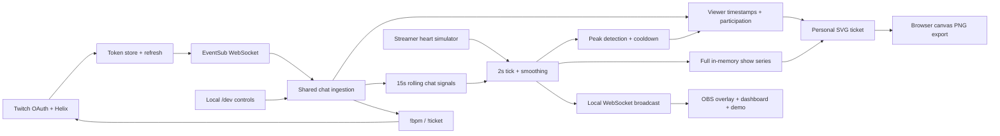

# BPM Log for Twitch

**A stream has a pulse. You were part of it.**

Built for the Codex × TwitchCon Hackathon. BPM Log puts two heartbeats on stream: a simulated streamer heart rate and the collective energy of Twitch chat. When the room erupts, it captures a peak. Every chatter can take home a personal concert ticket with their own messages glowing on the show's graph: proof they were there.

For streamers, it makes audience energy visible and gives peak moments a shared identity. For viewers, it turns participating in chat into a souvenir unique to them.

## Features

- Twitch OAuth Authorization Code login, saved tokens, automatic refresh, and hourly validation.
- EventSub WebSocket chat with keepalive watchdog, reconnection, reconnect handoff, and deduplication.
- `!bpm` reports the two current heartbeats; `!ticket` replies with the chatter's ticket URL.
- Crowd BPM combines rolling messages/minute, unique chatters, emote fragments, and hype signals. Values smoothly map to 60–180 BPM.
- Streamer heart-rate simulator: resting random walk, crowd response, occasional spikes, and a manual spike button. **All streamer BPM values are simulated.** A marked source integration stub lives in `engine.js`; HypeRate/Pulsoid are not implemented.
- Peaks require Crowd BPM above the prior rolling average by 16 BPM, and above 95 BPM, for at least four seconds. Each has a 30-second cooldown, 12-second participation window after detection, maxima, top chatters, and sample messages.
- Transparent OBS lower third, three-minute graph, BPM-synced heart animation, and peak banners.
- Demo studio with fake viewers, normal chat, hype bursts, emote spam, heart spikes, and show reset. Fake and real messages share the same ingestion pipeline.
- Personal 1200 × 630 SVG ticket with a perforated stub, stable serial number, full-show graph, message dots, peak credits, and client-side PNG export.

## Setup on macOS

Requires **Node.js 22+**. Only Express and `ws` are dependencies; there are no native packages, build steps, external fonts, or CDN assets.

```sh
npm install
# .env is already created. If setting up a fresh clone:
cp -n .env.example .env
npm start
```

Open **http://localhost:3000**. The demo works immediately without Twitch credentials.

### Connect Twitch

1. Register an application at [Twitch Developer Console](https://dev.twitch.tv/console/apps). Twitch requires two-factor authentication on your account to register applications.
2. Set OAuth Redirect URL to exactly **http://localhost:3000/callback**, and choose the **Confidential** client type. Category: **Chat Bot**.
3. Generate a client secret. Fill in `.env`:

   ```dotenv
   TWITCH_CLIENT_ID=your_client_id
   TWITCH_CLIENT_SECRET=your_client_secret
   PORT=3000
   ```

4. Restart `npm start` and open **http://localhost:3000/login**. Authorize the broadcaster account with `user:read:chat user:write:chat user:bot`.
5. The same account is broadcaster and bot. Check the dashboard for **EVENTSUB CONNECTED**. Send `!bpm` or `!ticket` from that same account in your own chat. Bot replies carry a `[BPM Log] ` prefix; only marked replies from the bot account are ignored to prevent loops and inflated crowd energy. Each chatter has a five-second command cooldown.

`.env`, `.tokens.json`, and `node_modules/` are ignored by Git. Tokens are saved locally with owner-only creation permissions. Keep port 3000 for Twitch login: the OAuth callback is intentionally fixed to the requested URL, even if you change `PORT` for an offline demo.

Twitch references: [Authorization Code flow](https://dev.twitch.tv/docs/authentication/getting-tokens-oauth/#authorization-code-grant-flow), [refresh tokens](https://dev.twitch.tv/docs/authentication/refresh-tokens/), [chat authentication](https://dev.twitch.tv/docs/chat/authenticating/), [EventSub WebSocket handling](https://dev.twitch.tv/docs/eventsub/handling-websocket-events/), [Send Chat Message](https://dev.twitch.tv/docs/api/reference/#send-chat-message).

### OBS

Add a **Browser Source** with URL **http://localhost:3000/overlay**, width **1920**, height **1080**. Leave the background transparent. The graphics occupy the lower third; the rest is transparent. Streamer BPM is magenta, Crowd BPM is cyan, and peaks have numbered markers. The overlay reconnects if the server restarts.

## 90-second demo

1. Start the app, open `/dev`, and put `/overlay` in OBS or a second browser window. No login required.
2. Set the fake viewer to `frontrow_fan`. Click **Normal chatter** and let the baseline settle for about 15 seconds.
3. Say: “The stream has a heartbeat. So does chat.” Click **Hype burst**. Crowd BPM climbs, streamer BPM follows, and a peak banner appears in roughly 6–10 seconds.
4. Click **Spike streamer heart** for an obvious magenta rise. Try **Emote spam** to show fragment-based excitement scoring.
5. Click **View my ticket**. Point out the fan's glowing message dots and “You were there for Peak #1.” Download the PNG.
6. Say: “This is a concert ticket for a live stream. Everybody gets a different one.” Change the username, inject a burst, and open that viewer's ticket.
7. Use **Reset show** before another demo. It cancels all running bursts and clears every ticket and graph.

If a second burst does not trigger a peak, let the room quiet down: peaks need a rise above baseline and a 30-second cooldown. During a burst, the chosen viewer participates every second, alongside other simulated fans.

## Architecture



- `server.js`: Express routes, shared ingestion, commands, local demo bursts, WebSocket broadcasting.
- `twitch.js`: OAuth, Helix, token lifecycle, EventSub connection lifecycle.
- `engine.js`: crowd calculation, streamer simulation, peaks, viewer records, and full time series.
- `public/`: dependency-free browser UI, SVG graphs, transparent overlay, ticket artwork and PNG export.
- `test/engine.test.js`: deterministic tests for peaks, attribution, cooldown, signals, simulation, and resets.

The engine runs every two seconds. Crowd activity is `0.35 × messages/min + 2 × unique chatters + 0.9 × emote fragments + 1.8 × hype signals`, over a rolling 15-second window. It maps through `60 + 120 × (1 − exp(−activity/65))`, then approaches the target by 32% per tick. The prior 60-second series provides the peak baseline.

## MVP boundaries

All show data is in memory. Restarting or resetting clears it, including viewer tickets. Download tickets before the show ends. “Minutes present” estimates the span between a viewer's first and last messages, rounded up with a one-minute minimum; it does not claim to measure silent watch time. Viewer activity is recorded only after the app connects.

The server binds to the local Mac. The requested `!ticket` URL uses **localhost**, so it opens on the streamer's computer for this demo; remote Twitch viewers cannot reach it on their own devices. Public hosting, a public ticket base URL, and protected demo controls are required before using it for a real distributed audience. This MVP deliberately stays local.

## Checks

```sh
npm test
```

Then check `/`, `/dev`, `/overlay`, `/ticket/frontrow_fan`, and PNG export in your browser. Twitch OAuth and chat need your credentials; engine tests do not contact Twitch.

## How we used Codex

Codex implemented this MVP from the hackathon brief: the Twitch login and EventSub adapter, shared message pipeline, deterministic engine tests, OBS overlay, demo studio, and personal SVG ticket with browser PNG export. It also wrote this setup and demo guide. The build was organized in five milestones so each layer could be reviewed before adding the next.

The build environment blocked registry network access and Git metadata writes. As a result, live Twitch authorization and milestone commits could not be completed there. To initialize version control on your Mac if needed:

```sh
git init
git add .
git commit -m "BPM Log for Twitch MVP"
```
